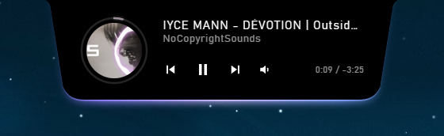
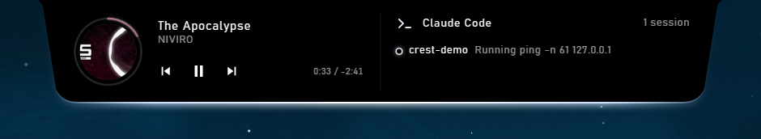

# Crest

<p align="center">
  
</p>

> **A personal hobby project**: something I wanted on my own desktop, so I built it. Works on my setup (Windows 11, YouTube Music in Brave, the Spotify app); shared as-is, no support guaranteed.

A small black notch hanging from the top center of the screen. It shows what's playing in any player that appears in Windows' own media controls (built with YouTube Music in Brave, also tested with the Spotify desktop app), grows when you rest the pointer on it, lets your clicks through to whatever is under it while closed, and hides when there's nothing to show; resting the pointer against the top edge of the screen then brings it down with the time, the date and a volume slider. Windows 11 first; Linux (KDE Plasma on Wayland) later.

Built with [Tauri 2](https://v2.tauri.app/): a Rust backend and a TypeScript + Vite frontend drawn with plain CSS/SVG. Everything stays on your machine: no telemetry, and no network calls unless you switch on an integration that needs them (none does yet: the Claude Code integration stays on your PC).

> Status: 0.5.0 is published ([download](../../releases/latest)). New in 0.5.0: a new look (a notch with sloped sides whose lit edge tells you what's going on, the song's progress as a ring around its cover, a wide and shallow dashboard, a wider permission alert); a speaker button and slider in the music tile for the system volume; the closed notch lets your clicks through to whatever is under it and opens when you rest the pointer on it; with nothing playing, resting the pointer against the top edge brings it down with the time, the date and the volume; an MCP tool's input in the permission alert; and fixes for fullscreen games across two monitors and for the notch's place after login or a resolution or monitor change. Since 0.4.0, off until you switch it on: [Claude Code](#claude-code) sessions in the notch, with Allow / Deny for their permission requests. See [What it looks like](#what-it-looks-like).

Crest's tray icon (notification area, possibly behind the ^ arrow) has **Settings…** and **Quit Crest**. Starting Crest again while it runs also opens the settings.

## What it looks like

Closed, it's a small black notch with sloped sides (a "visor") showing the cover in its progress ring and the title; a click on it goes to whatever is under it (a browser tab, say). Rest the pointer on it for a moment (or wait for a new song) and it glides open; with music and Claude Code at once, it opens into a dashboard with one tile each, music always on the left. It slides up into the screen edge when there's nothing to show; push the pointer against the top edge where it hangs and hold still for a moment, and it comes down open with the time, the date and the volume slider, until you move away.

<p align="center">
  
</p>

In the open music tile, a speaker button after next-track slides out a thin slider for the **system volume** (all sound, like the speaker icon in the taskbar). The playback buttons step aside while it's open; it follows the volume keys, the mouse wheel moves it 2 % per notch, and it slides back by itself a few seconds after you leave it. Moving it while muted turns the sound back on, as Windows' own slider does. It isn't a replacement for Windows' volume popup.

<p align="center">
  
</p>

The notch's lower edge is lit, and the light says what's going on, so you don't have to read anything:

- **gold**: a Claude Code session needs your OK;
- **white**: Claude Code is working, even while music plays;
- **green**: a session has just finished, until you've looked (opened the pill);
- **violet**: music is playing (dimmer while paused). Music has a colour of its own on purpose: a cover's colours could look like a status. The song's own colours are in the ring around its cover;
- **dim white**: everything else, like a session waiting for you.

A change of colour travels along the edge as one sweep of light, and a new track or a new status line sends one sweep too; then the light stands still. The text is Windows 11's own Bahnschrift, so nothing extra is bundled.

<sub>Music in the demo: "DÉVOTION" by IYCE MANN, and "No Rival" by Egzod, Maestro Chives and Alaina Cross, NCS releases, provided by [NoCopyrightSounds](https://ncs.io).</sub>

## What makes Crest different

- **Private by default.** Crest sends no telemetry and needs no account. It reads what's playing only from Windows' own media controls (SMTC): no scraping, no unofficial APIs, no cookies. Future integrations will be off until you switch them on, use free APIs only, talk to their own service only, and keep any keys in Windows Credential Manager (never in files).
- **Light on your PC.** Everything is event-driven, with no polling loops: nothing runs while idle, paused or hidden (measured: 0.1% of one core with the pill hidden, WebView2's own housekeeping). The one thing that wakes it is the mouse moving: Crest gets a copy of each mouse report so the closed pill can open when you rest on it (measured: about 0.5% of one core while the mouse moves non-stop, nothing while it's still). While music plays, the progress ring moves once a second, together with the time while open; the light only moves for a moment when something changes. While hidden, Crest asks WebView2 to keep as little in RAM as it can: about 16–40 MB in Task Manager (measured). The settings window only exists while it's open.
- **Built for Linux too (planned).** All Windows-specific code (media and window behavior) sits behind small interfaces, so a KDE Plasma on Wayland version can plug in next to it: MPRIS for media, layer-shell for the pill window. Not built yet.

## How it's built

I build Crest with [Claude Code](https://claude.com/claude-code) as my coding agent. I decide what Crest should do and how it should behave, test every change on my own setup, and report what I see; Claude Code helps me with code and debugs, following the rules in `CLAUDE.md`.

## How it works, in plain language

Crest has two halves that talk to each other:

- **The backend (Rust, `src-tauri/`)** knows what's going on in the system: what music is playing, where the screen is, when to show or hide the pill.
- **The frontend (TypeScript, `src/`)** runs inside a small web view in the pill window and only draws what the backend tells it, and sends button presses back.

They talk through **Tauri events** (backend → frontend: "here's what to show now") and **Tauri commands** (frontend → backend: "the user pressed Next").

### Activities and sources (the plugin idea)

The pill shows **activities**, like "music is playing" or "Claude Code is working". Activities come from **sources**. Music and Claude Code are the two sources today; a timer could be another later.

- Every source implements the same small Rust trait, `ActivitySource`. It reports updates ("this is what I'd show, this is how important it is, is it still ongoing?") and handles actions (like "next-track"). A button press travels as `(activity kind, action name)`; the `ActivitySourceRegistry` hands it to the source of that kind, and the result comes back as an ordinary update.
- The **core** (`activity_core/`) keeps the latest update from each source and decides what the pill shows and whether it's visible. It never looks inside a source's content, so adding a new source doesn't change the core.
- On the frontend, a small registry maps each activity kind (like `"music"`) to the views that draw it.

### When the pill is on screen

The core also decides visibility, with rules in one small pure function (`pill_visibility_policy.rs`, unit-tested):

- something **ongoing** (music playing) → visible, and it stays visible;
- something **lingering** (music paused) → hidden after 30 seconds; a new track shows it again first;
- **nothing** (the player closed) → hidden after 3 seconds;
- the pointer **rests against the top edge** where the hidden pill hangs (0.4 s, no click) → shown open until the pointer leaves it, then hidden again unless something came on meanwhile (never over a fullscreen app);
- a **fullscreen app** covers the pill's monitor → hidden at once, without an animation, and back when it leaves. Crest learns this from the Windows shell, the same signal that hides the taskbar (`fullscreen_detection/`).

`pill_visibility_controller.rs` runs those countdowns and tells the frontend, which plays a short fade/shrink animation and then asks Rust to hide the native window (or shows the window first, then animates the pill in). A hide never happens while the mouse is over the pill.

### Media: one trait, one implementation per operating system

The music source doesn't talk to Windows directly. It uses a trait, `MediaSource`: "tell me when the current media session changes" and "play / pause / next / previous".

- **Windows** (`media/windows_smtc/`): uses the System Media Transport Controls (SMTC), the same system that feeds the media flyout next to the volume slider. Browsers publish what a web page plays there through the Media Session API, which is how we see YouTube Music without any unofficial API. A dedicated background thread waits for SMTC events (no polling), so it uses no CPU while nothing changes.
- **Linux, later** (`media/linux_mpris/`): a second struct implementing the same `MediaSource` trait over MPRIS, the D-Bus standard that Linux media players and browsers use. `media/mod.rs` picks the implementation for the current OS at compile time (`#[cfg(target_os = ...)]`), so nothing else in the app changes.

Which players the pill may show is a `MediaPlayerFilter`: every player, or only a list. The settings window changes it while the media thread runs, by sending it a message, so the pill follows at once.

### System volume: the same idea, its own small channel

The volume slider isn't an activity (it doesn't decide what the pill shows), so it has its own event and two commands: "here's the volume now" (`{ level, isMuted }`, or nothing when there's no output device), "what is it now?" and "set it to this level". Behind them is another small trait, `SystemVolumePlatform`.

- **Windows** (`system_volume/windows_core_audio/`): Core Audio, the API behind the taskbar's speaker slider. One background thread owns everything; Windows calls Crest back when the level, the mute or the default output device changes (speakers → headphones), and those callbacks only send the thread a message. No polling.
- **Crest's own changes:** every level Crest sets carries an ID of Crest's, and Windows hands that ID back in its change notification. So Crest knows which changes it made itself and doesn't send them back to the slider, where a late echo of an earlier drag step would pull the knob backwards.
- **The page** listens only while the open music tile is on screen, and sends at most one new level every 50 ms while you drag (always ending on where you let go).

Measured: with the pill hidden, Crest used no measurable CPU over a minute with the volume watching running, and an open slider costs about the same as a closed one.

### The window and the animation

The open pill is as wide and tall as what it shows (one tile, the dashboard, the wider permission alert), and the native window is always as big as the largest open pill (plus the notch's shoulders and its 12-pixel underglow), sits at the very top of the chosen monitor, and only moves when you choose another monitor or the monitors change (a resolution switch, one plugged in or unplugged: Windows tells every window with `WM_DISPLAYCHANGE`). What changes is its **interactive area**: only the rectangle where the pill currently is takes the mouse; everywhere else, clicks go to the app below. The closed pill takes no clicks at all: the window is "layered" and, while closed, `WS_EX_TRANSPARENT`, so Windows passes every click through it. To still open it, Rust watches the mouse with raw input (`pointer_watching/`: a copy of every mouse report goes to a sleeping thread, which never sits in the mouse's path) and tells the page when the pointer has rested on the closed pill for 0.3 s without a click. Windows also draws only inside that rectangle, which is why the underglow stays small: the rectangle includes it. Growing (opening, or taller content while open): the area grows first, then CSS animates the capsule. Shrinking: the capsule animates first, then the area shrinks. Resizing the real window during the animation would make the pill jump for a frame, because the web content re-lays itself out slightly after Windows resizes the window.

On the frontend, `pillStateMachine.ts` decides *when* the pill is compact or expanded (a rest on the closed pill, leaving, a new track), and `pillMorphController.ts` carries it out. The notch's outline is one CSS `clip-path: shape()` written in percentages, so it follows the size while CSS animates it (an ease-in-out glide, no overshoot); the light is two gradient layers behind it, and a blurred copy below is the underglow. The progress ring is redrawn on each whole second of the song, together with the time, rather than at the monitor's refresh rate: on a 240 Hz screen, the old CSS-animated playing bars once cost about 35% of a CPU core. Each activity kind provides a *view set* (a compact and an expanded view) through `activityViewRegistry.ts`, the frontend's plugin point.

### The settings window

A second window (`settings.html`), created when you open it and destroyed when you close it, so it costs nothing the rest of the time. It changes settings only through Crest's own Rust commands. `build.rs` lists every command, so Tauri makes a permission for each, and each window's capability file (`src-tauri/capabilities/`) grants only its own: the pill page can't change settings, and the settings page can't move the pill's window.

### Platform traits

Window behavior works the same way as media: a small trait, `PillWindowPlatform`, for "stay out of the taskbar and Alt+Tab", "show without taking focus" and "only this rectangle takes the mouse". `pill_window/mod.rs` picks the implementation for the current OS with `#[cfg(target_os = ...)]`. The Windows implementation sets Win32 window styles itself and shows the window with `SW_SHOWNOACTIVATE`, because Tauri's own `show()` would take focus. On Wayland a normal window can't place itself or stay on top, so KDE will get its own implementation (layer-shell) in `pill_window/linux_layer_shell/`.

## Current file tree

```
Crest/
├─ CLAUDE.md                    standing rules for AI-assisted sessions
├─ README.md                    this file
├─ LICENSE                      MIT
├─ dev-tools/                   debugging helpers, not part of the app (see dev-tools/README.md)
├─ docs/                        the demo GIF and screenshot shown in this README
├─ .gitignore                   ignores node_modules, dist, build output
├─ .gitattributes               LF line endings everywhere (Windows and Linux)
├─ .claude/launch.json          dev-server config for Claude's preview pane (port 1420)
├─ .vscode/extensions.json      recommends the Tauri and rust-analyzer VS Code extensions
├─ package.json                 npm scripts and frontend dependencies
├─ tsconfig.json                strict TypeScript settings
├─ vite.config.ts               Vite dev server settings Tauri expects (fixed port 1420)
├─ index.html                   the page loaded into the pill window
├─ settings.html                the page loaded into the settings window
├─ src/
│  ├─ main.ts                   pill entry: wires the pill together, places it, then reveals the window
│  ├─ frontendConstants.ts      every size and delay (single source of truth; sent to Rust and CSS)
│  ├─ vite-env.d.ts             lets TypeScript understand Vite imports such as CSS files
│  ├─ ipc/
│  │  ├─ ipcChannelNames.ts     command, event and activity-kind names shared with Rust
│  │  ├─ listenForRustStateChanges.ts   receives Rust-owned state (listens, then asks once)
│  │  ├─ requestPillWindowPlacement.ts  asks Rust to size the window and put it at the top of its monitor
│  │  ├─ requestPillTopEdgeOpeningRelease.ts  the pill opened from the top edge closed: Rust may hide it again
│  │  ├─ requestPillInteractiveArea.ts  asks Rust which rectangle takes the mouse
│  │  ├─ requestPillWindowReveal.ts     asks Rust to show the window without taking focus
│  │  ├─ requestPillWindowConceal.ts    asks Rust to hide the window
│  │  ├─ requestActivityAction.ts       sends a button press to the activity's Rust source
│  │  ├─ requestActivityFocus.ts        the companion was clicked: make it main, or mark its news seen
│  │  ├─ createRustStateFollower.ts     follows Rust-owned state only while it's shown (listens on show, stops on hide)
│  │  └─ requestSystemVolumeLevel.ts    asks Rust to set the system volume
│  ├─ pill/
│  │  ├─ pillShellElements.ts          the notch: underglow, light, and the Visor with its compact layer (main slot + the companion's mark at the end) and expanded layer
│  │  ├─ pillDimensionCssVariables.ts  hands the sizes from frontendConstants.ts to CSS
│  │  ├─ pillStateMachine.ts           when to be compact or expanded (a rest, leaving, peek, held open by an alert)
│  │  ├─ pillPointerInput.ts           mouse events on the open pill → state machine; a click on the companion's mark
│  │  ├─ listenForPointerRestOnClosedPill.ts  Rust's "the pointer rests on the closed pill" → open it (on the companion if on its mark)
│  │  ├─ pillMorphController.ts        animates a state or height change and keeps the interactive area in step
│  │  ├─ pillMorphSettleDetector.ts    says when a size animation has ended (its event, or a timer if it never comes)
│  │  ├─ calculatePillInteractiveArea.ts  the rectangle that takes the mouse (and the only part Windows draws): pill, shoulders, underglow; closed = lets clicks through
│  │  ├─ pillVisibilityController.ts   slides the notch in/out and shows/hides the native window; opens it from the top edge
│  │  ├─ pillVisibilityTypes.ts        the visibility Rust sends (visible? fullscreen app in front?)
│  │  ├─ waitUntilNextFrameIsPainted.ts  resolves once the current content is on screen
│  │  ├─ pillAttentionDetector.ts      whose news opens the pill: the leading activity's, else the companion's
│  │  ├─ pillDashboardLayout.ts        the open pill: one tile per activity, side by side, each as wide as its view says, and the pill's size
│  │  ├─ pillContentPresenter.ts       puts the views in place: leading in the main slot, the companion's mark at the end, the open pill: the alert, the tile with news, or the dashboard
│  │  ├─ decidePillLightKind.ts        the light rule: gold, white, green until seen, violet for music, dim
│  │  ├─ describePillLightNews.ts      what counts as news for a sweep (a new track, a new status line)
│  │  ├─ pillLightController.ts        decides the light from what Rust sends and what the user has seen
│  │  ├─ pillLightPainter.ts           paints it: a sweep for a new colour or news, a fade for dimming
│  │  └─ readPillLightPalette.ts       the light's colours and strengths, read once from the design tokens
│  ├─ activities/
│  │  ├─ pillArrangementTypes.ts     the shape of what Rust sends (alert, main, companion)
│  │  ├─ findLeadingActivity.ts      the alert if there is one, else the main activity
│  │  ├─ orderActivitiesByTilePosition.ts  every activity keeps its place in the dashboard (music left)
│  │  ├─ activityViewSet.ts          what an activity's views must provide
│  │  ├─ activityViewRegistry.ts     activity kind → its view set (plugin point)
│  │  ├─ nothingToShowViewSet.ts     shown for an activity kind the page doesn't know
│  │  ├─ idle/
│  │  │  ├─ idleViewSet.ts           nothing on: the time, the date and the volume slider (always out)
│  │  │  └─ idleClockTicker.ts       redraws the time once a minute, only while seen
│  │  ├─ createSvgIconElement.ts     builds an inline SVG icon
│  │  ├─ claudeCode/
│  │  │  ├─ claudeCodeStatusTypes.ts     the Claude Code payload's shape
│  │  │  ├─ claudeCodeViewSet.ts         the Claude Code activity's views; the open one is the list or the alert
│  │  │  ├─ compactClaudeCodeView.ts     terminal mark, what the most urgent session is doing, "+N"
│  │  │  ├─ companionClaudeCodeView.ts   next to the music: only the terminal mark, coloured by status
│  │  │  ├─ expandedClaudeCodeView.ts    every session, most urgent first, "+N more"
│  │  │  ├─ claudeCodeSessionRowElement.ts  one session: status dot, project folder, what it's doing
│  │  │  ├─ calculateClaudeCodeExpandedHeight.ts  the open view's height for its number of rows
│  │  │  ├─ claudeCodePermissionAlertView.ts  a permission request: session, command, MCP call or action, Allow / Deny
│  │  │  ├─ claudeCodePermissionCommandBox.ts  the command, wrapped, 3 rows tall and scrolling; knows when all was seen
│  │  │  ├─ claudeCodePermissionAnswerButtons.ts  Deny / Allow: a short pause, one answer, Allow only once all was seen
│  │  │  ├─ estimateClaudeCodeCommandRowCount.ts  how many rows a command wraps into (sizes the box)
│  │  │  ├─ calculateClaudeCodePermissionAlertHeight.ts  the alert's height for the request's rows
│  │  │  ├─ describeClaudeCodeSessionStatus.ts  "Working" / the tool / "Done" / "Waiting for you" / "Needs your OK" / "Usage limit", "· 1 subagent"
│  │  │  ├─ formatUsageLimitResetTime.ts  "1:50", or "Fri 9:00" for a reset on another day
│  │  │  ├─ claudeCodeProductName.ts     the name both Claude Code headers show
│  │  │  └─ claudeCodeTerminalIconPath.ts  a plain ">_" (not Anthropic's logo)
│  │  └─ music/
│  │     ├─ nowPlayingTypes.ts       the music payload's shape
│  │     ├─ musicViewSet.ts          the music activity's views; reads the cover's colours once for their rings
│  │     ├─ compactMusicView.ts      the cover in its progress ring, the title
│  │     ├─ companionMusicView.ts    next to another activity: only the cover in its small ring
│  │     ├─ expandedMusicView.ts     the cover in its ring, title, artist, buttons, the speaker, the time
│  │     ├─ systemVolumeControl.ts   the speaker button and the slider it slides out; closes by itself (or always out, in the idle tile)
│  │     ├─ systemVolumeSlider.ts    the volume line (a real range input), the level as a number, the wheel
│  │     ├─ systemVolumeSpeakerIcons.ts  speaker icons: muted, one wave, two waves
│  │     ├─ systemVolumeTypes.ts     the system volume's shape
│  │     ├─ createLatestValueThrottle.ts  while dragging: at most one new level every 50 ms, always the last
│  │     ├─ albumArtImage.ts         album art with a placeholder when missing and a ring while loading
│  │     ├─ coverProgressGauge.ts    the round cover inside a ring showing the song's progress
│  │     ├─ playbackPositionTicker.ts  the song's position between Rust's reports; redraws only while playing and seen
│  │     ├─ sampleAlbumArtRingColors.ts  three colours from the cover for its ring, read once per track
│  │     └─ musicControlButtons.ts   previous / play-pause / next, dimmed when the player refuses one
│  ├─ settings/
│  │  ├─ settingsWindowMain.ts       settings entry: fills the cards
│  │  ├─ settingRowElement.ts        one row: title, explanation, control
│  │  ├─ launchAtLoginSettingRow.ts  "Start with Windows" switch
│  │  ├─ pillDisplaySettingRow.ts    "Show the pill on" monitor list
│  │  ├─ allowedPlayersSettingCard.ts  "Show every player", the player list, adding open players
│  │  ├─ claudeCodeIntegrationSettingCard.ts  the Claude Code switches + exactly what they add to Claude Code's settings
│  │  └─ crestBuildDescriptionLine.ts  the About card: which Crest is running
│  └─ styles/
│     ├─ designTokens.css       every color, spacing, duration, the glide curve and the light's colours (pill and settings)
│     ├─ pillShell.css          transparent page, the notch's box and layers, the morph and slide animations
│     ├─ pillVisorOutline.css   the Visor's outline (one clip-path for the notch, its light and its glow)
│     ├─ pillLight.css          the lit edge, the underglow, the sweep, and the marks following the light
│     ├─ settingsWindow.css     the settings window, in the style of Windows 11's settings
│     └─ albumArtImage.css, coverProgressGauge.css, compactMusicView.css, expandedMusicView.css,
│        musicControlButtons.css, systemVolumeControl.css, idleView.css,
│        compactClaudeCodeView.css, expandedClaudeCodeView.css, companionMarkViews.css,
│        claudeCodePermissionAlertView.css, pillDashboardLayout.css
└─ src-tauri/
   ├─ Cargo.toml                Rust package and dependencies (`windows` crate only on Windows)
   ├─ build.rs                  Tauri's build step; lists Crest's commands so each gets a permission
   ├─ tauri.conf.json           app name, pill window flags, content security policy, bundling
   ├─ capabilities/
   │  ├─ default.json           what the pill page may call
   │  └─ settings_window.json   what the settings page may call
   ├─ icons/                    app icons generated from crest-icon-source.svg (`npx tauri icon ...`)
   ├─ windows/
   │  └─ crest_installer_hooks.nsh  the uninstaller's extra step: take Crest's hooks out of Claude Code's settings
   └─ src/
      ├─ main.rs                program entry; `--claude-code-hook` runs the hook, `--remove-claude-code-hooks` removes the hooks (for the uninstaller), both exit before Tauri starts
      ├─ lib.rs                 wires the app: plugins, pill window, core, activity sources, commands
      ├─ backend_constants.rs   every Rust constant (windows, settings, priorities, timings)
      ├─ ipc_channel_names.rs   event, activity-kind and action names shared with the frontend
      ├─ user_settings_store.rs settings.json: loads it, keeps the current settings, saves safely (unit-tested)
      ├─ text_file_atomic_replacement.rs  writes a temporary file, then renames it over the real one
      ├─ launch_at_login/
      │  ├─ mod.rs
      │  ├─ launch_at_login_switch.rs       "Start with Windows" on/off through tauri-plugin-autostart
      │  ├─ launch_at_login_repair.rs       at startup: puts the entry back if an update deleted it or it points at a removed Crest (unit-tested)
      │  └─ windows_run_key_registration.rs reads Windows' Run entry and whether its program still exists (unit-tested)
      ├─ system_tray.rs         tray icon with "Settings…" and "Quit Crest"
      ├─ activity_core/
      │  ├─ mod.rs
      │  ├─ activity_source.rs         trait every activity plugin implements
      │  ├─ activity_update.rs         what a source reports (priority, lingering/ongoing/alert, attention key, payload)
      │  ├─ activity_publisher.rs      a source's handle for reporting to the core
      │  ├─ activity_arbiter.rs        keeps every source's latest update, notifies the frontend of layout changes (unit-tested)
      │  ├─ pill_activity_arrangement.rs  where each activity goes: alert, main, companion (pure, unit-tested)
      │  ├─ activity_source_registry.rs   running sources by kind; routes actions (unit-tested)
      │  ├─ activity_action_command.rs    command: a button press for some activity kind
      │  ├─ pill_arrangement_command.rs   lets the frontend ask for the current layout
      │  ├─ focus_activity_command.rs     command: the companion was clicked (ongoing → main; news → seen)
      │  ├─ pill_visibility_policy.rs     the show/hide rules as a pure function (unit-tested)
      │  ├─ pill_visibility_controller.rs runs the hide countdowns, adds the fullscreen rule and the top-edge opening, reports changes
      │  ├─ pill_visibility_command.rs    lets the frontend ask whether the pill is visible
      │  └─ pill_top_edge_opening_command.rs  the pill opened from the top edge closed: hide it again unless something is on
      ├─ activity_sources/
      │  ├─ mod.rs
      │  ├─ claude_code/
      │  │  ├─ mod.rs
      │  │  ├─ claude_code_activity_source.rs     hook events → Claude Code activity; exists only while switched on
      │  │  ├─ claude_code_status_thread.rs       owns the tracker and the permission queue, answers the hooks
      │  │  ├─ claude_code_permission_queue.rs    permission requests waiting for Allow / Deny, each hook answered once (pure, unit-tested)
      │  │  ├─ claude_code_permission_answer.rs   the alert's button actions and the hook's allow / deny JSON (unit-tested)
      │  │  ├─ claude_code_permission_description.rs  what the alert shows: the whole command or MCP call, hidden characters made visible (unit-tested)
      │  │  ├─ claude_code_permission_action_wording.rs  other tools in a few words: "Edit src\main.ts", "Open github.com" (unit-tested)
      │  │  ├─ claude_code_permission_tool_call_listing.rs  an MCP tool's input, one "key: value" line per field (unit-tested)
      │  │  ├─ claude_code_permission_file_path.rs  a requested file from the project folder, else its full path with "~" (unit-tested)
      │  │  ├─ claude_code_permission_answering_switch.rs  "Answer permission requests in the pill", shared with the status thread
      │  │  ├─ claude_code_hook_event.rs          the hook fields Crest reads; which events it asks for
      │  │  ├─ claude_code_session_tracker.rs     every session, its order, the news counter, the silence timeout (pure, unit-tested)
      │  │  ├─ claude_code_tracked_session.rs     one session's state and how each event changes it
      │  │  ├─ claude_code_running_subagents.rs   the subagents a session runs; "Running 2 subagents" (unit-tested)
      │  │  ├─ claude_code_usage_limit_wait.rs    a session stopped by a usage limit stays listed until the reset
      │  │  ├─ claude_code_session_list.rs        the sessions the pill lists: order, how many, "+N" (pure, unit-tested)
      │  │  ├─ claude_code_tool_summary.rs        "Editing notes.md", "Running cargo test" (unit-tested)
      │  │  ├─ claude_code_hook_registration.rs   adds/removes Crest's hooks in Claude Code's settings, nothing else (unit-tested)
      │  │  ├─ claude_code_settings_file.rs       reads and writes ~/.claude/settings.json, with a backup
      │  │  ├─ claude_code_integration_switch.rs  hooks and listening always switch on and off together
      │  │  ├─ claude_code_status_message.rs      what wakes the status thread (event, transcript change, answer, stop)
      │  │  ├─ claude_code_interrupt_watch.rs     while a session is busy: watches its transcript for an interrupt, a deny or stopped subagents
      │  │  ├─ claude_code_transcript_interrupt.rs  recognizes the interrupt and "agents stopped" lines (no hook for either; unit-tested)
      │  │  ├─ claude_code_transcript_continuation.rs  a session Claude Code continued under a new id leaves the list (unit-tested)
      │  │  ├─ claude_code_transcript_usage_limit.rs  when a reached usage limit resets, from the transcript (unit-tested)
      │  │  ├─ transcript_end_text.rs             reads a transcript's last few KB once
      │  │  ├─ transcript_tail_reader.rs          reads only the lines added since the last look (unit-tested)
      │  │  └─ last_path_part.rs                  a project folder's or file's name from its path (unit-tested)
      │  └─ music/
      │     ├─ mod.rs
      │     ├─ music_activity_source.rs     media snapshots → music activity
      │     └─ session_loss_grace_period.rs ignores the short session gap on track change (unit-tested)
      ├─ media/
      │  ├─ mod.rs              declares the module; picks this OS's implementation
      │  ├─ media_source.rs     trait: watch media sessions, send play/pause/next/previous, hand out the filter control
      │  ├─ media_session_snapshot.rs  title, artist, album, art, play state, timeline, enabled buttons
      │  ├─ media_session_selector.rs  which allowed session to show (unit-tested)
      │  ├─ media_player_filter.rs     every player, or only a list; how list entries match (unit-tested)
      │  ├─ media_player_filter_control.rs  lets the settings window list players and change the filter
      │  ├─ media_app_identifier_label.rs   readable player names for the settings window (unit-tested)
      │  ├─ album_art_settle_gate.rs   holds a new track's art back 300 ms ("loading"), skipping placeholders (unit-tested)
      │  ├─ pending_transport_commands.rs  button presses kept while the session is briefly gone (unit-tested)
      │  └─ windows_smtc/
      │     ├─ mod.rs
      │     ├─ smtc_media_source.rs        Windows MediaSource: starts the worker thread
      │     ├─ smtc_worker_thread.rs       WinRT setup + the event loop
      │     ├─ smtc_worker_message.rs      what can wake the worker (events, button presses, a new filter)
      │     ├─ smtc_event_subscriptions.rs SMTC events → messages to the worker
      │     ├─ smtc_transport_commands.rs  play/pause, next, previous on a session
      │     ├─ smtc_session_tracker.rs     known sessions, last activity, what was sent, held presses
      │     ├─ smtc_tracked_session.rs     subscribes to every session; one listened-to session + lookup by app
      │     ├─ smtc_snapshot_reader.rs     WinRT properties → snapshot
      │     └─ smtc_thumbnail_reader.rs    album art → data URL, read fresh on every update
      ├─ claude_code_hook_channel/
      │  ├─ mod.rs
      │  ├─ claude_code_hook_channel_trait.rs  trait: carry a hook event to Crest and the answer back, no network
      │  ├─ claude_code_hook_process.rs        what `crest.exe --claude-code-hook` does
      │  ├─ length_prefixed_message.rs         the message format on the channel (unit-tested)
      │  ├─ pending_hook_reply.rs              trait: a hook's answer sent later (a permission request waits for a click)
      │  └─ windows_named_pipe/
      │     ├─ mod.rs
      │     ├─ named_pipe_claude_code_hook_channel.rs  the pipe's per-user name (a real round trip is unit-tested)
      │     ├─ named_pipe_hook_event_server.rs  Crest's end: waits for hooks, refuses to share the name
      │     ├─ named_pipe_pending_hook_reply.rs  a connected hook waiting for its answer; dropped = "no decision"
      │     ├─ named_pipe_hook_event_client.rs  the hook's end: only talks to a Crest of the same user
      │     └─ windows_user_identity.rs         user SIDs; the pipe's "this user only" access rule
      ├─ folder_change_watching/
      │  ├─ mod.rs
      │  ├─ folder_change_watch.rs         trait: tell me when a file in this folder is written
      │  └─ windows_change_notification.rs Windows: FindFirstChangeNotificationW, one sleeping thread (tested for real)
      ├─ fullscreen_detection/
      │  ├─ mod.rs
      │  ├─ fullscreen_app_watcher.rs     trait: tell me when a fullscreen app comes and goes; "check again" after the pill moves
      │  └─ windows_shell_appbar/
      │     ├─ mod.rs
      │     ├─ appbar_fullscreen_app_watcher.rs   own thread + hidden appbar window that Windows notifies
      │     ├─ appbar_watcher_window_procedure.rs reacts to the fullscreen notification, a short settle timer, Explorer restarts, "check again"
      │     ├─ appbar_watcher_thread_state.rs     what the window procedure needs, per thread
      │     ├─ front_window_change_hook.rs        re-checks on every front-window change (one on another monitor keeps the answer)
      │     └─ front_window_fullscreen_check.rs   does the front window cover the pill's monitor?
      ├─ system_volume/
      │  ├─ mod.rs              declares the module; picks this OS's implementation
      │  ├─ system_volume_platform.rs   trait: watch the system volume, set its level
      │  ├─ system_volume_level.rs      a valid level: 0 to 1 in whole percent (unit-tested)
      │  ├─ system_volume_reading.rs    what the OS reports, and what the page shows
      │  ├─ system_volume_announcer.rs  keeps the current volume; tells the page only real changes, never Crest's own (unit-tested)
      │  ├─ system_volume_commands.rs   the two commands the pill page calls
      │  ├─ system_volume_startup.rs    starts watching when Crest starts
      │  └─ windows_core_audio/
      │     ├─ mod.rs
      │     ├─ core_audio_system_volume.rs        Windows SystemVolumePlatform: starts the worker thread
      │     ├─ core_audio_worker_thread.rs        COM setup + the message loop; owns every Core Audio object
      │     ├─ core_audio_worker_message.rs       what can wake the worker (a change, a new device, a requested level)
      │     ├─ default_output_follower.rs         opens the default output device, again when it changes
      │     ├─ watched_output_endpoint.rs         the device's volume control with Crest's callback registered
      │     ├─ endpoint_volume_change_callback.rs Windows calls it on a level or mute change (unit-tested)
      │     └─ default_output_change_callback.rs  Windows calls it when the default device changes (unit-tested)
      ├─ pill_window/
      │  ├─ mod.rs              declares the module; picks this OS's implementation
      │  ├─ pill_window_platform.rs    trait: the OS-specific overlay behavior
      │  ├─ pill_window_placement.rs   top-center math in physical pixels on the chosen monitor (unit-tested)
      │  ├─ pill_display_choice.rs     chosen monitor or the main one; labels for the settings list (unit-tested)
      │  ├─ pill_display_change_follower.rs  a monitor change → the page places the pill again
      │  ├─ connected_display_reader.rs  the monitors Windows reports right now
      │  ├─ pill_interactive_area.rs   CSS pixels → physical pixels for the interactive area (unit-tested)
      │  ├─ pill_window_commands.rs    the commands the pill page calls
      │  └─ windows_native/
      │     ├─ mod.rs
      │     ├─ classic_frame_painting_blocker.rs  Win32 subclass: stops the classic title bar being painted (white bar)
      │     ├─ display_change_forwarder.rs        Win32 subclass: passes WM_DISPLAYCHANGE on
      │     ├─ webview_memory_usage_target.rs     asks WebView2 to keep little in RAM while the pill is hidden
      │     └─ windows_pill_window_platform.rs  Win32: tool-window style, show without focus, hide, window region, click-through
      ├─ pointer_watching/
      │  ├─ mod.rs              declares the module; picks this OS's implementation
      │  ├─ pointer_watch.rs              trait: report the pointer anywhere without taking it; one timer
      │  ├─ pointer_rest_detector.rs      when the pointer rests on the closed pill or the top edge: still, no click, once per visit (unit-tested)
      │  ├─ pointer_rest_zone.rs          a screen rectangle and what a rest there does (unit-tested)
      │  ├─ shared_pill_pointer_zones.rs  where the closed pill is, or the top edge while hidden; kept up to date by the window commands (unit-tested)
      │  ├─ pointer_rest_startup.rs       starts the watch; a rest goes to the page as an event
      │  └─ windows_raw_input/
      │     ├─ mod.rs
      │     ├─ raw_input_pointer_watch.rs        own thread, message-only window, raw input + the rest timer
      │     └─ raw_input_mouse_report_reader.rs  one report: a button down? where is the pointer?
      └─ settings_window/
         ├─ mod.rs
         ├─ settings_window_opener.rs    opens the window or brings it to the front (tray, second launch)
         ├─ settings_window_commands.rs  the commands the settings page calls
         ├─ claude_code_integration_commands.rs  the Claude Code switches and their preview
         ├─ crest_build_description.rs   version, release/dev, build time and path for the About card
         └─ allowed_player_options.rs    what the player card shows (unit-tested)
```

## Installing

Download `Crest_<version>_x64-setup.exe` from the [Releases](../../releases) page and run it (Windows 10/11, 64-bit). The installer isn't code-signed, so SmartScreen will warn: **More info → Run anyway**.

## Running it from source

Prerequisites on Windows: Rust (`stable-msvc`), Microsoft C++ Build Tools with "Desktop development with C++", Node.js. WebView2 ships with Windows 11.

```powershell
npm install
npm run tauri dev     # run with hot reload
npm run tauri build   # installer in src-tauri\target\release\bundle\nsis\
```

## Settings

Open them from the tray icon (**Settings…**) or by starting Crest again while it runs:

- **Start with Windows**: Crest starts in the background when you sign in. Off by default. Crest remembers your choice: Windows' installer removes the start-up entry when an update uninstalls the old version first, and Crest puts it back the next time it starts.
- **Show the pill on**: the main display, or a specific monitor. If that monitor is unplugged, the pill goes to the main display at once.
- **Claude Code**: shows what your Claude Code sessions are doing (see [Claude Code](#claude-code)). Off by default.
- **Answer permission requests in the pill**: Allow / Deny right in the pill while Claude Code is on. On by default; off, the pill only shows the status.
- **Allowed players**: which players the pill shows. A new install shows **every player**; switch that off to show only the list (it starts with YouTube Music), and add any player while it's open (a video in a normal browser tab counts as one player per browser, e.g. "Brave tabs"). With an empty list and the switch off, the pill shows no music.

The **About** card at the bottom shows which Crest is running (version, release or dev build, when it was built, and the file's location).

Changes apply at once and are saved in `%APPDATA%\dev.crest.pill\settings.json`, outside the install folder, so updates keep them (uninstalling removes them only if you tick "Delete the application data"). You don't need to edit the file; if you do, a list entry matches a player's exact app ID (ignoring case), except an entry starting with `_crx_`, which matches that web app in any Chromium browser:

```json
{
  "allowedMediaAppIdentifierFragments": ["_crx_cinhimbnkkghhklpknlkffjgod"],
  "showEveryMediaPlayer": false,
  "shouldLaunchAtLogin": false,
  "pillDisplayName": null,
  "isClaudeCodeIntegrationOn": false,
  "isClaudeCodePermissionAnsweringOn": true
}
```

Before 0.3.0 entries matched any app ID that *contained* them, and an empty list meant every player. A file without `showEveryMediaPlayer` keeps that meaning for an empty list; a hand-written part of an ID (like `spotify`) now needs to be the full ID (`Spotify.exe`), which the settings window fills in for you.

## Claude Code

Since 0.4.0, off by default. Switched on in the settings, the pill shows what your [Claude Code](https://claude.com/claude-code) sessions are doing: working (and the tool it runs, or "Running 2 subagents"), done, waiting for you, that it needs your OK, or that it stopped on a usage limit (with when the limit resets, e.g. "Usage limit · resets 1:50"). Subagents still running beside another line are counted after it ("Editing main.rs · 1 subagent"), and a session whose turn has ended while background subagents still run stays "Running 3 subagents" (and on screen) until the last one finishes. Next to playing music it shows only its `>_` mark at the end of the notch (rest the pointer on it to open the notch on Claude Code), and the notch's lit edge tells you its state: white while working, gold when it needs you, red when a session has just hit a usage limit and green when one has just finished (both until you've looked). Opened, the notch shows music and Claude Code side by side, with every session listed, most urgent first.

**Allow / Deny in the pill.** When Claude Code asks for permission, the pill opens as a wide alert with the project folder, the command (or "Edit src\main.ts", "Open github.com", …; for a connected MCP tool its name and every input field, like `github: create issue` then `title: …`) and **Allow** / **Deny**. Claude Code's own question stays open at the same time, and the first answer wins; the alert goes away when either side answers. Deny stops Claude, like Claude Code's own "No". To make sure you only allow what you've read:

- the buttons ignore clicks for half a second after the alert appears or the next request moves up (which also flashes once);
- a command (or an MCP tool's input) longer than 3 rows scrolls, and Allow works only once you've scrolled to its end;
- a command or MCP tool call too long to send to the pill (over 4,000 characters) can only be denied there: answer it in Claude Code;
- invisible characters and characters that change the text's direction show as `�`, so what you read is what runs;
- a web page is named by its real host (`https://github.com@evil.example/` shows as evil.example);
- a file is named by where it is: from the project folder when it's inside it (`Edit src\main.ts`), else by its full path, with your home folder as `~` (`Edit ~\.claude\settings.json`).

Claude Code's own deny and ask rules still apply after an Allow from the pill. Claude's questions to you (AskUserQuestion) and plan approval stay in Claude Code: the pill only says the session needs you.

**What it changes.** Switching on adds hook entries to Claude Code's user settings (`~/.claude/settings.json`); the settings window shows exactly which before you switch, keeps a copy of the file first, and switching off (or uninstalling Crest) removes only Crest's entries. Each hook runs `crest.exe --claude-code-hook`, which hands the event to the running Crest through a named pipe that only your Windows user can open (the hook also checks the pipe belongs to your user) and exits. Nothing leaves your PC: no network, no account. A Claude Code session keeps the hooks it read when it started, so after switching on (or changing the second switch) restart the sessions that are already running.

## Known limits

- A prompt cancelled with Esc right after sending it leaves the pill on "Working" until the session's next prompt, or for up to 10 minutes: Claude Code reports no event for it.
- A terminal closed hard (without ending Claude Code) stays in the session list for up to 10 minutes.
- A single tool that runs longer than 10 minutes (a long build or test run) sends no events meanwhile, so its session leaves the pill until the tool finishes.
- While a fullscreen app covers the pill's monitor, the pill (and a permission alert) is hidden: answer in Claude Code.

## License

A personal hobby project. [MIT](LICENSE). Not affiliated with Google or YouTube; it only reads what Windows already shares through its media controls.
